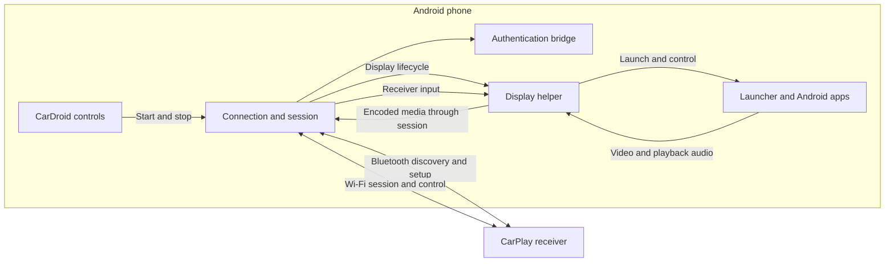

# CarDroid architecture

CarDroid manages the receiver connection on the phone. A display helper runs the launcher and selected Android apps on a separate virtual display, then sends their video and supported playback audio to the receiver. Receiver input is routed back to that display.

The helper starts through Shizuku or ADB with shell privileges; root is not needed. Current service modes are `NONE` and `HELPER`: phone mirroring is disabled and no MediaProjection fallback is offered. Android Accessibility is not part of helper setup or input routing. The app declares no Accessibility service, so Play Protect does not treat it as one.

## Persistent launcher and embedded apps

`CarLauncherActivity` is the root on the helper's encoded `CarDroid Car` display. Its 96 dp rail remains outside the content area. `CarApps.launch` and mapped `requestUI` shortcuts select `CarDisplayState.appTarget`; they do not start an external activity on the outer car display. Widget and app-grid opens use the same selection path. The Recents panel lists launcher session app history and reopens selections, rather than promoting Android tasks over the rail. Generic receiver SHOW preserves the current selection; Now Playing retains the dashboard fallback. There is no dedicated assistant app-launch route in the current code (assistant playback audio remains supported).

Single-app content reuses `NativeAppPanel`: a private virtual display rendered into a `TextureView`, owned by the helper when available (see below). The shell helper validates display ownership and the chosen launcher component before launching or injecting input. Panel launches request separate tasks for standard activities, avoiding reuse of a dashboard task; third-party `singleTask`/`singleInstance` behavior can still prevent independent instances. The existing two dashboard panels remain mounted behind the content view. Covered/off-page panels reject touch and release held contacts when disabled; a background hit shield prevents taps reaching the covered launcher. Input is also disabled when the launcher is paused or the helper disconnects.

Rail and hardware Back reach the selected panel via helper `PANEL_KEY` (Back only); overlay Back first closes the overlay. Home returns to the dashboard, releasing the single-app panel. Hardware Home uses helper `GO_HOME`, whose launcher intent resets selection. A replaced/lost car display clears stale selection. The persistent rail replaces the former accessibility-owned corner Home button. Low-level helper LAUNCH/task commands remain available for diagnostics, not normal launcher navigation.

The connection layer handles discovery, pairing, Wi-Fi handoff, media transport, and receiver commands. The authentication bridge supplies the authentication operations required by that session. Compatibility depends on the phone, Android version, permissions, and receiver.

## Phone locked or screen off

Car apps keep running while the phone is locked or its screen is off. On Android 14+ the helper creates a shell-owned companion Virtual Device for each car session (the companion association `com.android.shell` / `02:ca:4d:00:00:01` is created once and reused). The car display and every app panel are displays of that device: they form their own always-unlocked power group, kept awake by the helper's user-activity pokes, so the phone's own display can time out, sleep and show the keyguard normally. Plain virtual displays cannot do this: on separate-timeouts builds (for example HyperOS on Android 16) every virtual display joins the phone's power group, whatever flags it asks for.

Panels are created by the helper, not the app. On CONTROL connect the helper hands a panel-host binder to the app's `HelperBridgeProvider` (shell UID only). `NativePanelView` then asks it for a display rendering into its `TextureView` surface. The helper tracks those displays for the panel ownership check and releases them when the app dies or the car display stops. Without a Virtual Device (older Android, or creation refused), the car display and the panels fall back to plain displays, which sleep with the phone.

See the [protocol notes](PROTOCOL.md) for wire details and the [roadmap](ROADMAP.md) for development priorities.
